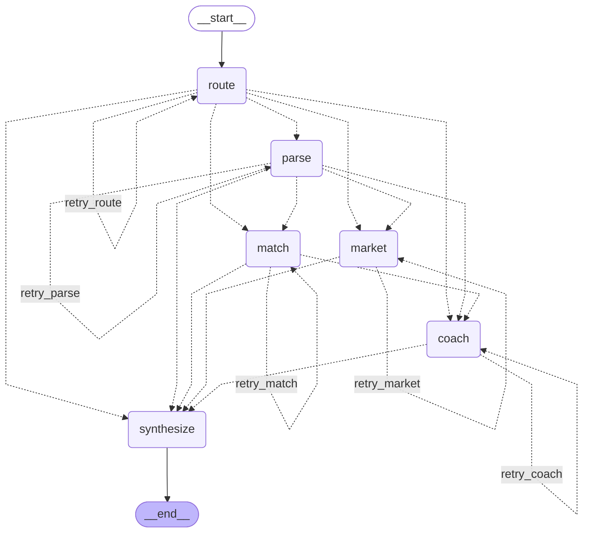

# LangGraph Multi-Agent StateGraph Architecture

This document presents the visual topology and node transition semantics of the LangGraph StateGraph orchestrator (`app/services/graph_orchestrator.py`).

## 1. Graph Mermaid Diagram

## 2. Node Semantics & State Propagation

1. **`route`**: Entry node from `__start__`. Evaluates the query using the trained multinomial Naive Bayes intent router (or heuristic fallback) and sets the target strategy. Supports bounded cyclic retry (`retry_route`) on transient exceptions.
2. **`parse`**: Executes resume parsing via `parser_agent` or reads structured resume data from the database. Passes candidate skills and experience forward.
3. **`match`**: Executes dense semantic retrieval and qualification overlap scoring against active job postings.
4. **`market`**: Computes salary percentiles and trending market skill frequencies for the candidate's target role.
5. **`coach`**: Synthesizes skill gaps, learning roadmaps, and custom interview questions grounded in candidate experience.
6. **`synthesize`**: Synthesizes cross-agent results into a coherent user response, structured sources, actionable recommendations, and appends execution observability traces (`completed_nodes`, `node_timings_ms`, `retries`, and non-fatal error records).
7. **`__end__`**: Graph terminal state returning the final `ChatQueryResponse`.
